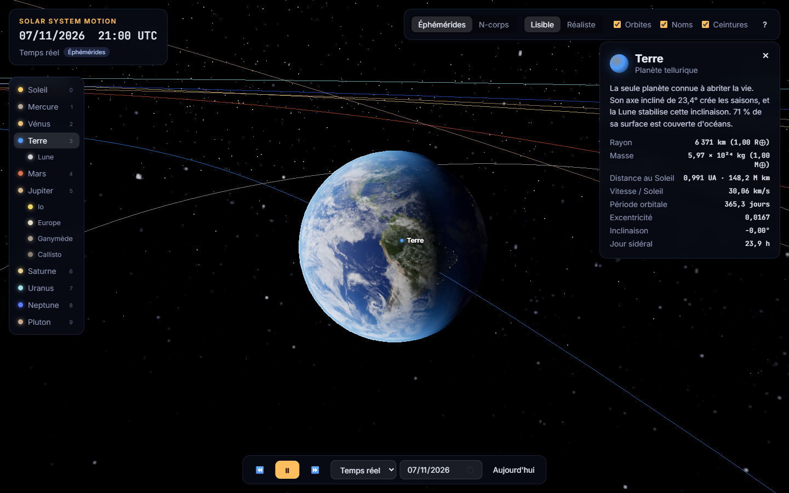

# Solar System Motion

Simulation 3D interactive du Système solaire dans le navigateur (Three.js).
Les planètes sont à leur **vraie position**, à n'importe quelle date, et un **bac à sable gravitationnel N-corps** permet de voir ce qui se passe quand on joue avec la gravité.


| La Terre (jour/nuit en temps réel) | Saturne et Titan | Mode N-corps |
|---|---|---|
|  |  |  |

## Fonctionnalités

**Deux modes de simulation**
- **Éphémérides** (par défaut) : positions calculées à partir des éléments orbitaux du JPL. Orbites elliptiques et inclinées, et positions réelles des planètes à la date affichée.
- **N-corps** : la gravité entre le Soleil et toutes les planètes est intégrée numériquement. Le bac à sable permet de :
  - multiplier la masse de Jupiter (jusqu'à ×1000) ou du Soleil ;
  - lancer une **étoile vagabonde** qui traverse le système ;
  - voir les **traînées** des trajectoires, la **dérive d'énergie** (qui mesure la qualité de l'intégrateur) et l'**écart en km** entre la simulation et les éphémérides pour la planète sélectionnée.

**Le temps**
- Démarre à la date et à l'heure actuelles (UTC).
- Vitesse de −1 an/s à +10 ans/s, temps réel compris. Pause et marche arrière.
- Saut à n'importe quelle date. Un badge signale quand on sort de la plage 1800–2050, où les éléments du JPL sont précis.

**Le rendu**
- Textures photographiques des planètes, de la Lune et du Soleil.
- Terre avec lumières des villes côté nuit, couche nuageuse et atmosphère. Jour et nuit correspondent à l'heure UTC réelle.
- Orientation réelle des axes et rotation de chaque astre, d'après le modèle de l'IAU (inclinaison de 23,4° pour la Terre, Uranus couchée, Vénus rétrograde…).
- Anneaux de Saturne, halo du Soleil (bloom), Voie lactée en fond.
- Ceinture d'astéroïdes (3 000 corps, lacunes de Kirkwood comprises) et ceinture de Kuiper.
- Lunes : la Lune, Io, Europe, Ganymède, Callisto, Titan, Triton (rétrograde) et Charon.

**L'échelle**
- **Lisible** : distances et tailles compressées pour tout voir d'un coup d'œil.
- **Réaliste** : distances et rayons à la vraie échelle. Les planètes deviennent invisibles, ce qui montre à quel point l'espace est vide.
- Le passage de l'une à l'autre est animé.

**L'interaction**
- Clic sur un astre (ou sur son nom) pour le suivre et afficher sa fiche : rayon, masse, distance au Soleil, vitesse, période, jour sidéral…
- Raccourcis clavier :

| Touche | Action |
|---|---|
| `Espace` | pause / lecture |
| `←` `→` | vitesse du temps |
| `0`–`9` | Soleil, Mercure … Pluton |
| `M` | mode éphémérides / N-corps |
| `S` | échelle lisible / réaliste |
| `O` `L` `B` | orbites, noms, ceintures |
| `T` | revenir à aujourd'hui |
| `Échap` | vue d'ensemble |

- Liens directs, par exemple : `?date=1969-07-20&focus=moon`, `?mode=nbody&rogue=1`, `?scale=real`.

## Lancer le projet

Aucune compilation n'est nécessaire : ce sont des modules ES natifs et Three.js est chargé depuis un CDN. Il faut seulement un serveur HTTP local, car les navigateurs bloquent les modules ouverts en `file://`.

```bash
git clone https://github.com/GuillBla/Solar-System-Motion.git
cd Solar-System-Motion
python -m http.server 8000
# puis ouvrir http://localhost:8000
```

Tests de la physique (Node ≥ 18) :

```bash
npm test
```

### Publier sur GitHub Pages

Dans *Settings → Pages*, choisir *Deploy from a branch*, puis la branche `main` et le dossier `/ (root)`. Le site sera accessible à l'adresse `https://<utilisateur>.github.io/Solar-System-Motion/`.

## La physique, en bref

### Mode éphémérides : les lois de Kepler

Chaque planète suit une ellipse décrite par 6 **éléments orbitaux** : demi-grand axe *a*, excentricité *e*, inclinaison *i*, longitude du nœud *Ω*, longitude du périhélie *ϖ* et longitude moyenne *L*. Le JPL publie ces valeurs pour l'époque J2000, avec leur lente dérive par siècle ([Standish, *Approximate Positions of the Planets*](https://ssd.jpl.nasa.gov/planets/approx_pos.html)).

Pour une date donnée :
1. on met à jour les éléments : `élément(T) = élément₀ + taux × T`, avec *T* en siècles depuis J2000 ;
2. on calcule l'anomalie moyenne `M = L − ϖ` ;
3. on résout l'**équation de Kepler** `M = E − e·sin E` par la méthode de Newton ;
4. on obtient la position dans le plan de l'orbite, puis on la tourne dans le repère écliptique.

Entre 1800 et 2050, l'erreur reste de l'ordre de quelques minutes d'arc au plus. C'est ce que vérifient les tests : périhélie et aphélie de la Terre, opposition de Mars en 2003, opposition de Jupiter en 2023, pleine lune du 25 janvier 2024…

### Mode N-corps : la gravité de Newton

Chaque corps est attiré par tous les autres : **a = Σ G·mⱼ·(rⱼ − r)/|rⱼ − r|³**.

- Unités astronomiques : UA, jours et masses solaires. On a alors *G = k²*, où *k* = 0,01720209895 est la constante de Gauss. Les nombres restent proches de 1, ce qui évite les erreurs d'arrondi.
- Intégrateur **leapfrog (kick-drift-kick)** avec un pas de 0,5 jour. Il est *symplectique*, donc l'énergie oscille sans dériver : environ 10⁻⁷ sur 100 ans. Il est aussi *réversible*, ce qui permet de remonter le temps.
- Les conditions initiales viennent des éphémérides à la date courante. La quantité de mouvement totale est ensuite annulée pour se placer dans le repère du barycentre.

Les lunes, elles, suivent une trajectoire calculée directement (cinématique), pas intégrée : la Lune boucle en 27 jours et Io en 1,8 jour, ce qui exigerait un pas de temps beaucoup plus petit.

## Structure

```
index.html            page + importmap (Three.js 0.160 via jsDelivr)
style.css             interface
src/
  main.js             scène, caméra, boucle de rendu
  simulation.js       horloge + modes éphémérides / N-corps
  ui.js               interface (contrôles, fiche, bac à sable, clavier)
  time.js             dates juliennes
  data/bodies.js      données physiques, orbitales et d'orientation
  physics/kepler.js   équation de Kepler, éléments orbitaux
  physics/nbody.js    intégrateur leapfrog
  physics/orientation.js  pôles et rotation (IAU), orbites des lunes
  render/             astres, orbites/traînées, ceintures, échelle, textures
tests/physics.test.js tests de la physique
legacy/               première version (Python / pygame)
```

## Crédits

- Textures : [Solar System Scope](https://www.solarsystemscope.com/textures/), licence [CC BY 4.0](https://creativecommons.org/licenses/by/4.0/). Les lunes sans texture photographique utilisent des textures procédurales.
- Éléments orbitaux : E. M. Standish, JPL Solar System Dynamics.
- Orientation des astres : rapport du groupe de travail de l'IAU sur les coordonnées cartographiques et les éléments de rotation (2015).
- Rendu : [Three.js](https://threejs.org).
