# Solar System Motion

Simulation 3D interactive du Système solaire dans le navigateur (Three.js).
Les planètes, les lunes, les comètes et les sondes sont à leur **vraie position**, à n'importe quelle date. Les **éclipses** se produisent au bon endroit et au bon moment, une **visite guidée** fait revivre les grands événements, et un **bac à sable gravitationnel N-corps** permet de voir ce qui se passe quand on joue avec la gravité.

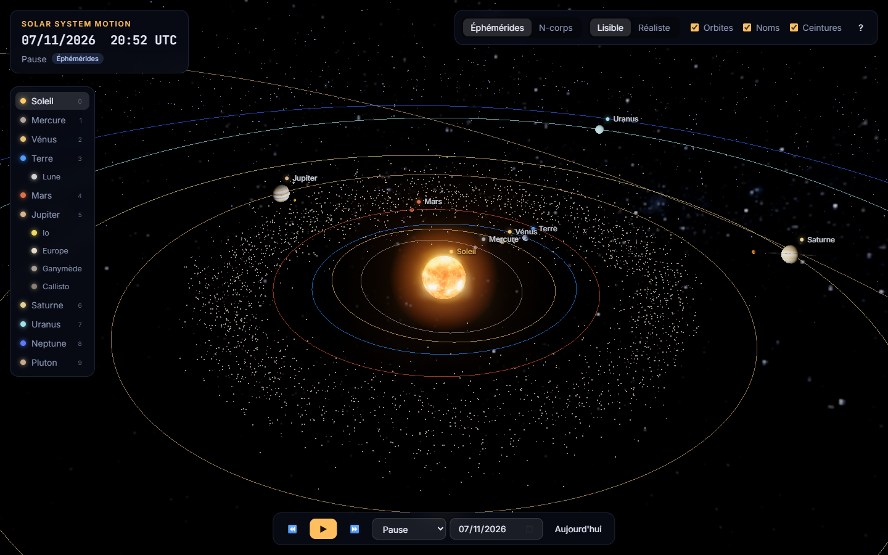

| Éclipse du 8 avril 2024 : l'ombre de la Lune sur le Mexique | Éclipse de Lune du 14 mars 2025 |
|---|---|
| 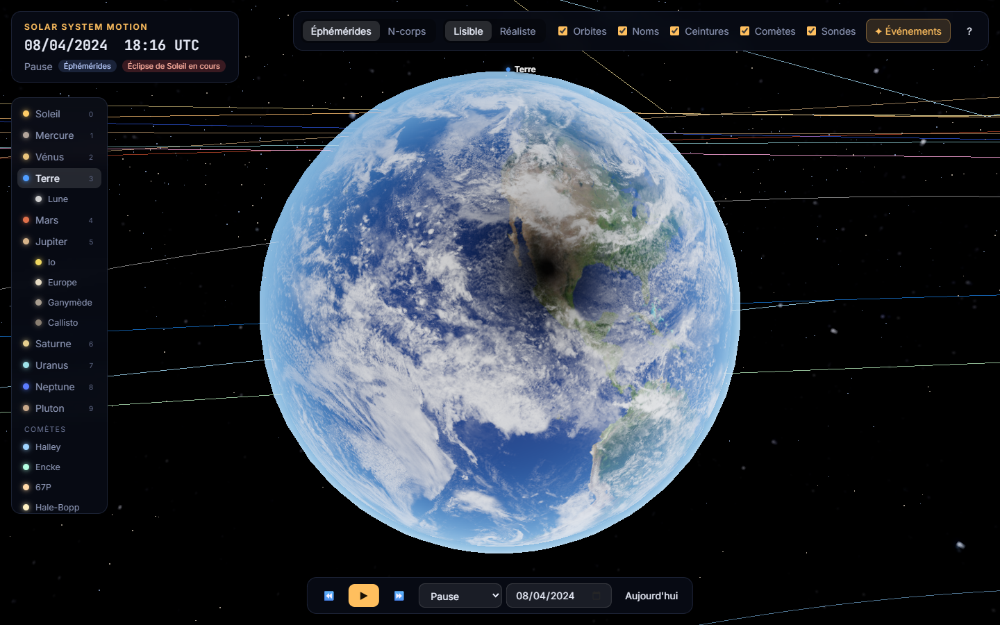 | 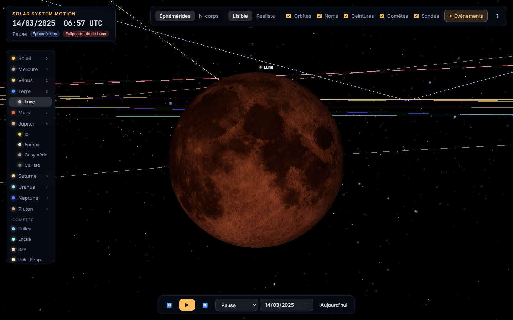 |
| **Voyager 2 frôle Neptune (25 août 1989, échelle réelle)** | **La comète de Halley en 1986** |
| 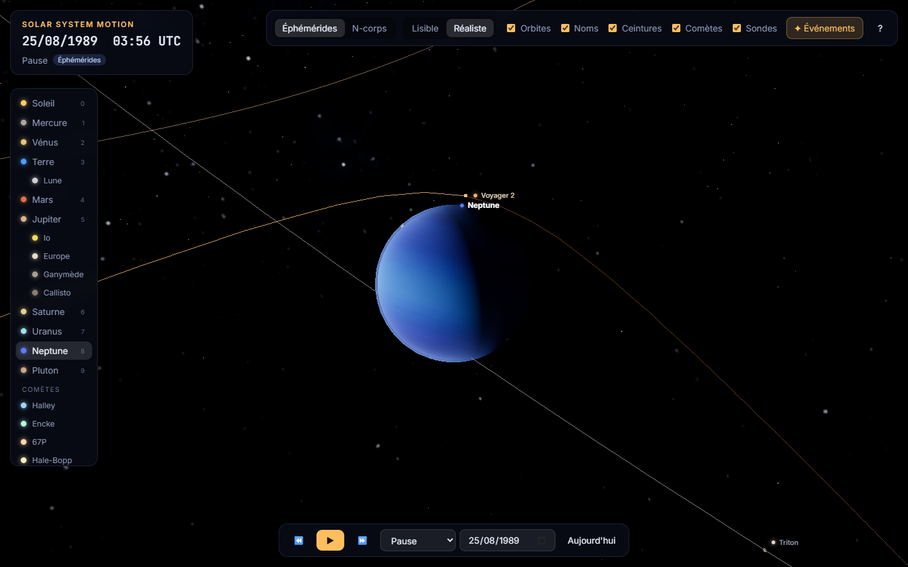 | 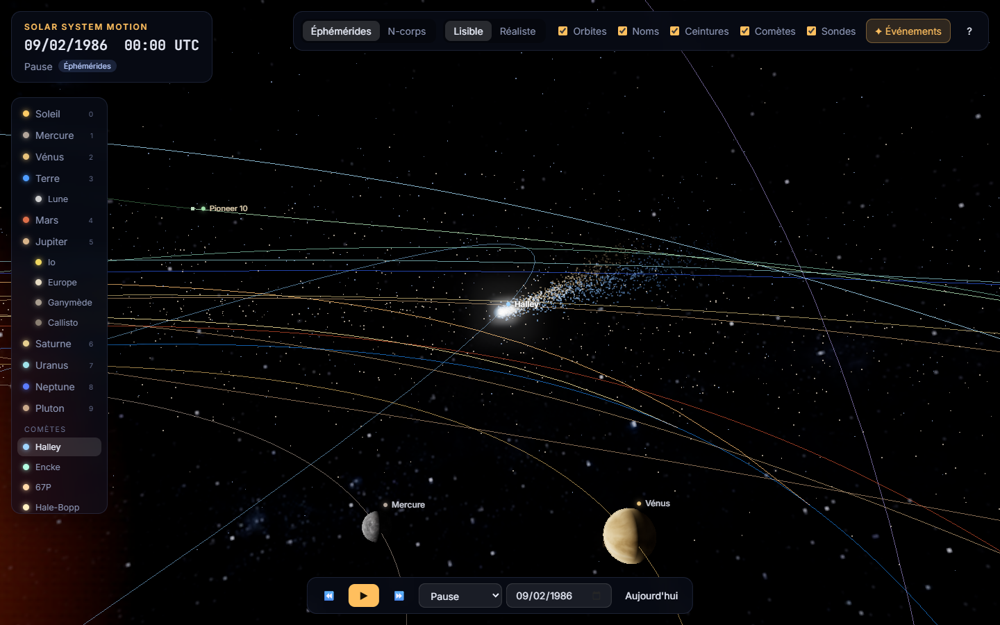 |
| **Saturne : ombre du globe sur les anneaux, et des anneaux sur le globe** | **Ombre d'Io sur Jupiter** |
| 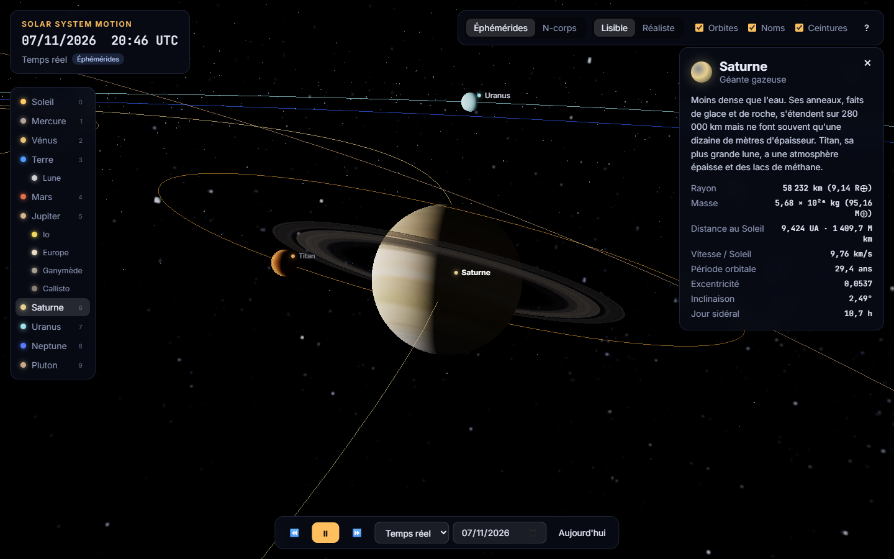 | 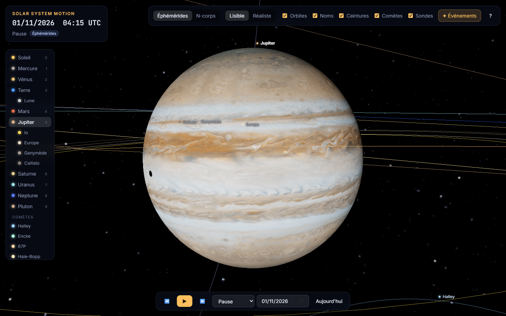 |
| **Visite guidée : 12 événements** | **Mode N-corps : Jupiter ×158 dévie les comètes** |
| 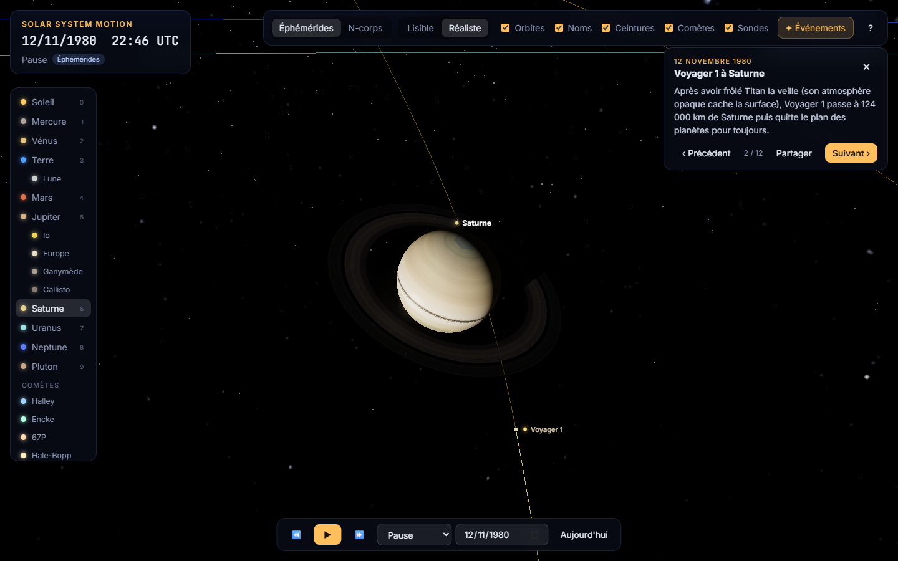 | 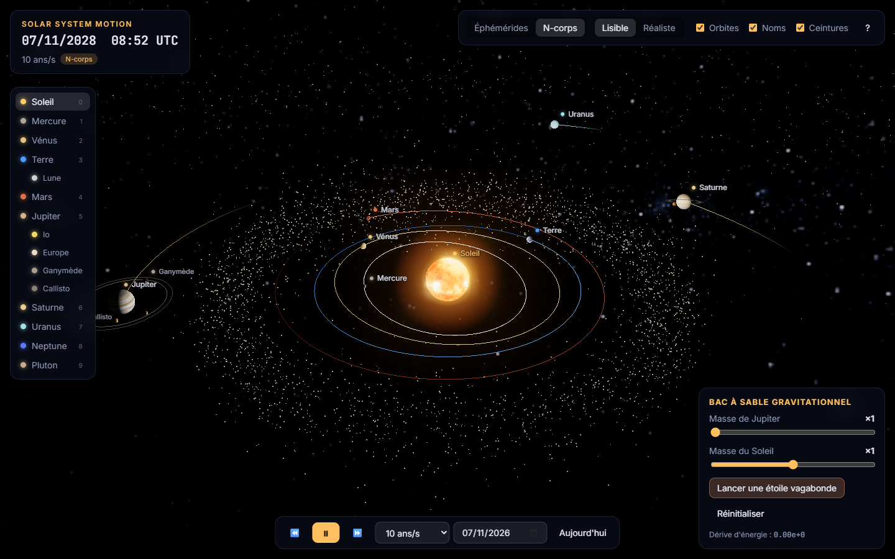 |
| **Fiche avec de vraies photos (ici Voyager 1)** | **Photo agrandie : Jupiter vue par Juno** |
| 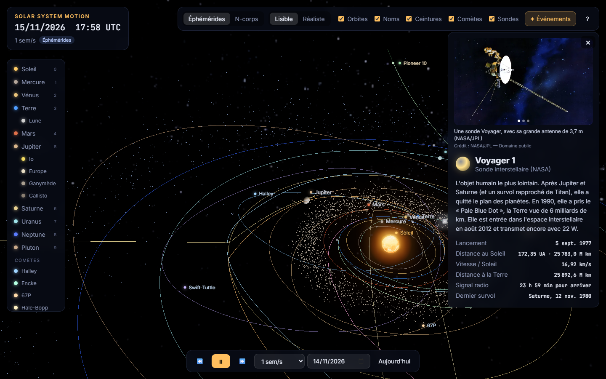 | 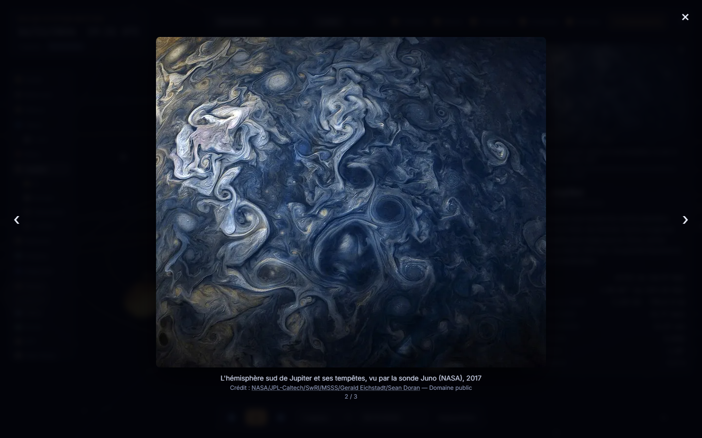 |

## Fonctionnalités

**Deux modes de simulation**
- **Éphémérides** (par défaut) : positions calculées à partir des éléments orbitaux du JPL. Orbites elliptiques et inclinées, et positions réelles à la date affichée.
- **N-corps** : la gravité entre le Soleil et les planètes est intégrée numériquement. Les comètes y sont des particules test sans masse : elles subissent la gravité des planètes. Le bac à sable permet de :
  - multiplier la masse de Jupiter (jusqu'à ×1000) ou du Soleil, et voir les comètes être déviées ;
  - lancer une **étoile vagabonde** qui traverse le système ;
  - voir les **traînées** des trajectoires, la **dérive d'énergie** (qui mesure la qualité de l'intégrateur) et l'**écart en km** avec les éphémérides pour l'astre sélectionné.

**Lunes et éclipses**
- La Lune suit la théorie ELP-2000 tronquée (Meeus) : à moins de 20 km de sa position réelle.
- Io, Europe, Ganymède, Callisto, Titan, Triton et Charon suivent des éléments moyens ajustés sur les éphémérides du JPL : à moins de 0,2° de leur position réelle entre 1975 et 2035.
- **Éclipses calculées dans les shaders** : pour chaque point de la surface, on calcule quelle fraction du disque solaire est cachée. Cela donne la pénombre douce et l'ombre nette, en kilomètres réels, donc justes dans les deux échelles :
  - ombre de la Lune sur la Terre (éclipses de Soleil) ;
  - ombre de la Terre sur la Lune, rougie par la lumière que réfracte l'atmosphère (éclipses de Lune) ;
  - ombres des lunes galiléennes sur Jupiter, et de Jupiter sur ses lunes ;
  - ombre des anneaux sur Saturne et de Saturne sur ses anneaux.
- Un badge signale quand une éclipse de Soleil ou de Lune est en cours.

**Comètes**
- Halley, Encke, Tchourioumov-Guérassimenko (67P), Hale-Bopp et Swift-Tuttle, de 1800 à 2100.
- Noyau, chevelure et deux queues : la **queue d'ions**, bleue et rectiligne, fuit le Soleil ; la **queue de poussières**, jaunâtre, s'incurve le long de l'orbite. Les queues grandissent à l'approche du Soleil et disparaissent au-delà de 5 UA environ.

**Sondes**
- Voyager 1 et 2, Pioneer 10 et 11, New Horizons : trajectoires réelles du JPL, du lancement jusqu'en 2050 ou 2100.
- Un pas de quelques minutes pendant les survols : la sonde passe au bon endroit à côté de la planète (Voyager 2 à 29 240 km du centre de Neptune, soit environ 4 900 km au-dessus des nuages du pôle nord). En échelle « Lisible », sa distance à la planète est compressée comme celle des lunes, pour qu'elle ne traverse pas la planète grossie.
- La partie déjà parcourue de la trajectoire est vive, la partie à venir est pâle.
- La fiche affiche la date de lancement, la distance au Soleil et à la Terre, la vitesse, le temps que met le signal radio pour arriver, et les survols passés et à venir.

**Visite guidée « Événements »**
Voyager 1 à Jupiter et à Saturne, Voyager 2 à Neptune, Halley en 1986, Hale-Bopp en 1997, Mars au plus près en 2003, New Horizons à Pluton, la grande conjonction de 2020, les éclipses de 2024, 2025 et 2026, et le retour de Halley en 2061. Chaque étape règle la date, la caméra, la vitesse et l'échelle, avec un texte explicatif. Une étape se partage par un lien `?event=…`.

**Vraies photos**
- Chaque astre, comète et sonde a sa fiche illustrée de 1 à 3 **photographies réelles** : Hubble, Cassini, Juno, Voyager, New Horizons, Rosetta, Apollo… (55 images).
- Légende en français et crédit cliquable sous chaque photo ; clic sur la photo pour l'agrandir (flèches du clavier pour passer à la suivante, `Échap` pour fermer).
- Toutes les images viennent de Wikimedia Commons, sous licence libre (domaine public, CC0, CC BY ou CC BY-SA). La liste complète des auteurs et licences est dans [CREDITS.md](CREDITS.md).

**Le temps**
- Démarre à la date et à l'heure actuelles (UTC).
- Vitesse de −1 an/s à +10 ans/s, temps réel et 10 min/s compris. Pause et marche arrière.
- Saut à n'importe quelle date. Un badge signale quand on sort de la plage 1800–2050, où les éléments des planètes sont précis.

**Le rendu**
- Textures photographiques des planètes, de la Lune et du Soleil.
- Terre avec lumières des villes côté nuit, couche nuageuse et atmosphère. Jour et nuit correspondent à l'heure UTC réelle.
- Orientation réelle des axes et rotation de chaque astre, d'après le modèle de l'IAU.
- Anneaux de Saturne, halo du Soleil (bloom), Voie lactée en fond, ceinture d'astéroïdes et ceinture de Kuiper.

**L'échelle**
- **Lisible** : distances et tailles compressées pour tout voir d'un coup d'œil.
- **Réaliste** : distances et rayons à la vraie échelle. Les planètes deviennent invisibles, ce qui montre à quel point l'espace est vide.
- Le passage de l'une à l'autre est animé.

**L'interaction**
- Clic sur un astre (ou sur son nom) pour le suivre et afficher sa fiche.
- Raccourcis clavier :

| Touche | Action |
|---|---|
| `Espace` | pause / lecture |
| `←` `→` | vitesse du temps |
| `0`–`9` | Soleil, Mercure … Pluton |
| `M` | mode éphémérides / N-corps |
| `S` | échelle lisible / réaliste |
| `O` `L` `B` | orbites, noms, ceintures |
| `C` `V` | comètes, sondes |
| `E` `N` | liste des événements, événement suivant |
| `T` | revenir à aujourd'hui |
| `Échap` | vue d'ensemble |

- Liens directs, par exemple : `?event=eclipse-2024`, `?date=1969-07-20&focus=moon`, `?focus=voyager1`, `?mode=nbody&rogue=1`, `?scale=real`.

## Lancer le projet

Aucune compilation n'est nécessaire : ce sont des modules ES natifs et Three.js est chargé depuis un CDN. Il faut seulement un serveur HTTP local, car les navigateurs bloquent les modules ouverts en `file://`.

```bash
git clone https://github.com/GuillBla/Solar-System-Motion.git
cd Solar-System-Motion
python -m http.server 8000
# puis ouvrir http://localhost:8000
```

Tests de la physique (Node ≥ 18) :

```bash
npm test
```

### Publier sur GitHub Pages

Dans *Settings → Pages*, choisir *Deploy from a branch*, puis la branche `main` et le dossier `/ (root)`. Le site sera accessible à l'adresse `https://<utilisateur>.github.io/Solar-System-Motion/`.

### Régénérer les données

Les fichiers de `data/` sont produits par des scripts Node (≥ 22) qui interrogent les API du JPL :

```bash
node tools/fit-moons.mjs          # data/moons.json      (éléments des lunes ajustés sur Horizons)
node tools/fetch-comets.mjs       # data/comets.json     (SBDB + éléments osculateurs Horizons)
node tools/fetch-spacecraft.mjs   # data/spacecraft.json (trajectoires des sondes)
node tools/fetch-reference.mjs    # tests/reference.json (positions de référence pour les tests)
node tools/check-spacecraft.mjs   # vérifie l'interpolation des sondes contre Horizons
python tools/fetch-photos.py     # images/photos/ + src/data/photos.js + CREDITS.md (Wikimedia Commons, Pillow requis)
node tools/screenshot.mjs out.png "http://localhost:8000/?event=eclipse-2024"   # capture (Chrome sans interface)
```

Poids total de `data/` : environ 1,15 Mo (≈ 410 ko compressés). Les trajectoires des sondes, qui en représentent l'essentiel, sont chargées après l'affichage de la scène. Les photos (`images/photos/`, WebP, ≈ 2,7 Mo au total) ne sont chargées qu'à l'ouverture de la fiche correspondante.

## La physique, en bref

### Planètes : les lois de Kepler

Chaque planète suit une ellipse décrite par 6 **éléments orbitaux** : demi-grand axe *a*, excentricité *e*, inclinaison *i*, longitude du nœud *Ω*, longitude du périhélie *ϖ* et longitude moyenne *L*. Le JPL publie ces valeurs pour l'époque J2000, avec leur lente dérive par siècle ([Standish, *Approximate Positions of the Planets*](https://ssd.jpl.nasa.gov/planets/approx_pos.html)).

Pour une date donnée :
1. on met à jour les éléments : `élément(T) = élément₀ + taux × T`, avec *T* en siècles depuis J2000 ;
2. on calcule l'anomalie moyenne `M = L − ϖ` ;
3. on résout l'**équation de Kepler** `M = E − e·sin E` par la méthode de Newton ;
4. on obtient la position dans le plan de l'orbite, puis on la tourne dans le repère écliptique.

Ces éléments donnent la position du barycentre de chaque système planète + lunes. La planète en est décalée selon la masse de ses lunes, ce qui compte surtout pour la Terre et Pluton (Charon pèse 12 % de Pluton).

### La Lune et les éclipses

- La Lune utilise les 60 termes principaux en longitude et distance, et les 60 en latitude, de la théorie **ELP-2000/82** (J. Meeus, *Astronomical Algorithms*, chapitre 47). On corrige de la précession pour revenir au repère J2000, et de **ΔT** (environ 69 s en 2024) : la Lune parcourt son propre diamètre en une heure, donc une minute d'écart déplace l'ombre d'une éclipse de 30 km.
- Les tests placent l'axe de l'ombre à 55 km du point de plus grande éclipse publié le 8 avril 2024 (Mexique), à 19 km le 12 août 2026 (au large de l'Islande), et retrouvent une magnitude de 1,195 pour l'éclipse de Lune du 14 mars 2025 (1,178 publiée).
- Dans les shaders, chaque fragment est replacé en kilomètres réels autour du centre de l'astre. On compare alors le rayon apparent du Soleil à celui de l'astre qui le masque, et l'aire du disque solaire cachée donne l'atténuation de la lumière.

### Lunes des planètes géantes

Le JPL publie des éléments moyens rapportés au **plan de Laplace** de chaque lune. On part de ces valeurs, puis on les ajuste par moindres carrés (Levenberg–Marquardt) sur 360 positions Horizons entre 1975 et 2035. Résultat : moins de 0,05° d'erreur pour Io, Callisto, Titan, Triton et Charon, et moins de 0,2° pour Europe et Ganymède.

### Comètes

Une ellipse fixe ne suffit pas : Jupiter modifie l'orbite des comètes à chaque passage. On stocke donc un jeu d'**éléments osculateurs** tous les 2 ans, de 1800 à 2100 (source : JPL Horizons, à partir des solutions du SBDB), et on utilise celui dont la date est la plus proche. On retrouve ainsi le périhélie de Halley le 9 février 1986 et le 28 juillet 2061, à moins d'un jour près.

### Sondes

Les états (position + vitesse) viennent de JPL Horizons et sont interpolés par des **polynômes de Hermite cubiques**. L'erreur, mesurée contre des points Horizons hors échantillon, est de 0,6 à 4 km pendant les survols et de 33 km au maximum en croisière.

Il reste un obstacle : la position approchée des planètes géantes peut être fausse de plusieurs centaines de milliers de km. Pendant un survol, on utilise donc la trajectoire de la sonde **relative à la planète** (Horizons, centre = la planète), ajoutée à la position de la planète **telle qu'elle est dessinée**. Au passage, il ne faut pas soustraire les positions héliocentriques de la sonde et de la planète fournies par Horizons : pour Voyager 2 à Neptune, on obtiendrait 34 558 km au lieu de 29 240 km.

### Mode N-corps : la gravité de Newton

Chaque corps est attiré par tous les autres : **a = Σ G·mⱼ·(rⱼ − r)/|rⱼ − r|³**.

- Unités astronomiques : UA, jours et masses solaires. On a alors *G = k²*, où *k* = 0,01720209895 est la constante de Gauss. Les nombres restent proches de 1, ce qui évite les erreurs d'arrondi.
- Intégrateur **leapfrog (kick-drift-kick)** avec un pas de 0,5 jour. Il est *symplectique*, donc l'énergie oscille sans dériver : environ 10⁻⁷ sur 100 ans. Il est aussi *réversible*, ce qui permet de remonter le temps.
- Les conditions initiales viennent des éphémérides à la date courante. La quantité de mouvement totale est ensuite annulée pour se placer dans le repère du barycentre.
- Les comètes ont une masse nulle : elles sont attirées par tout le reste sans attirer personne.

Les lunes et les sondes, elles, ne sont pas intégrées : leur trajectoire est calculée directement. La Lune boucle en 27 jours et Io en 1,8 jour, ce qui exigerait un pas de temps beaucoup plus petit.

## Structure

```
index.html              page + importmap (Three.js 0.160 via jsDelivr)
style.css               interface
data/                   données générées (lunes, comètes, sondes)
images/photos/          vraies photos des astres et des sondes (Wikimedia Commons)
CREDITS.md              auteurs et licences des photos
src/
  main.js               scène, caméra, boucle de rendu
  simulation.js         horloge + modes éphémérides / N-corps, sondes
  ui.js                 interface (contrôles, fiches, bac à sable, visite guidée, clavier)
  time.js               dates juliennes, ΔT
  data/                 astres, comètes, sondes, événements, chargement des JSON
  physics/kepler.js     équation de Kepler, éléments orbitaux
  physics/moon.js       Lune (ELP-2000 / Meeus)
  physics/satellites.js lunes des planètes (éléments moyens, plan de Laplace)
  physics/comets.js     comètes (jeux d'éléments osculateurs)
  physics/spacecraft.js trajectoires des sondes (interpolation de Hermite)
  physics/eclipse.js    géométrie des éclipses
  physics/nbody.js      intégrateur leapfrog
  physics/orientation.js  pôles et rotation (IAU)
  render/               astres, ombres (shaders), comètes, sondes, orbites, ceintures, échelle
tests/                  tests de la physique + positions de référence JPL
tools/                  scripts de génération des données et de capture
legacy/                 première version (Python / pygame)
```

## Crédits

- Textures : [Solar System Scope](https://www.solarsystemscope.com/textures/), licence [CC BY 4.0](https://creativecommons.org/licenses/by/4.0/). Les lunes et les noyaux de comètes sans texture photographique utilisent des textures procédurales.
- Éléments orbitaux des planètes : E. M. Standish, JPL Solar System Dynamics.
- Éphémérides de référence, trajectoires des sondes et éléments osculateurs des comètes : [JPL Horizons](https://ssd.jpl.nasa.gov/horizons/).
- Comètes : [JPL Small-Body Database (SBDB) API](https://ssd-api.jpl.nasa.gov/doc/sbdb.html).
- Lunes des planètes : [JPL Planetary Satellite Mean Elements](https://ssd.jpl.nasa.gov/sats/elem/).
- Lune : J. Meeus, *Astronomical Algorithms*, 2ᵉ éd., chap. 47 (théorie ELP-2000/82 de M. Chapront-Touzé et J. Chapront). ΔT : polynômes d'Espenak et Meeus.
- Orientation des astres : rapport du groupe de travail de l'IAU sur les coordonnées cartographiques et les éléments de rotation (2015).
- Photos : [Wikimedia Commons](https://commons.wikimedia.org/) — NASA, ESA, JPL et auteurs individuels ; détail fichier par fichier dans [CREDITS.md](CREDITS.md).
- Rendu : [Three.js](https://threejs.org).
